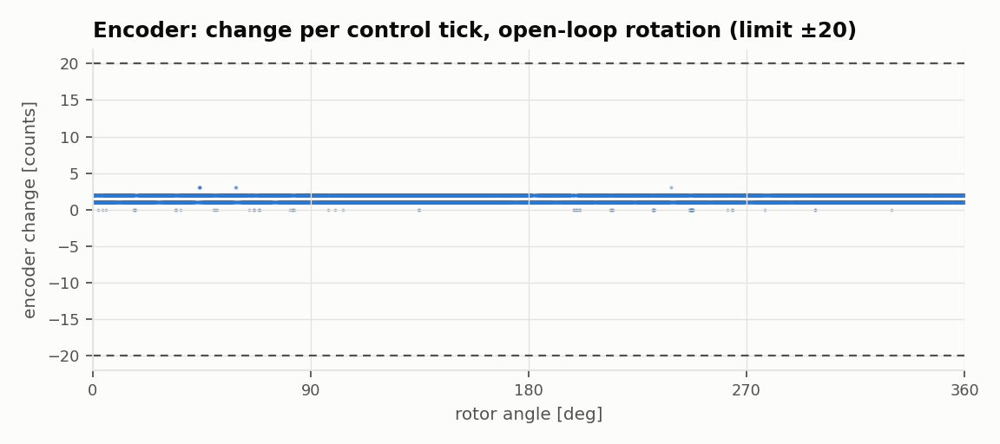

# Custom FOC ESC: Test Report

**1 / 1 requirements passed** · 2026-10-27 09:11 · N = 3 runs per test

## Conditions

| | |
|---|---|
| Firmware build | Oct 27 2026 08:25:57 (protocol v1) |
| Host commit | `efc540d-dirty` |
| Bus voltage | 12.00 V (KD3005P, 0.5 A limit) |
| Motor | GM4108H-120T, 11 pole pairs, no load |
| Current gains | Kp 2.06, Ki 9835 (firmware defaults) |
| Speed gains | Kp 0.01, Ki 0 |

## Requirements

Predicted values come from a model of the firmware's control loops using the R, L, Kt and J measured in this same run, so they test the design math, not just the hardware.

| ID | Requirement | Limit | Predicted | Measured (mean ± std) | Result |
|---|---|---|---|---|---|
| REQ-ENC-01 | Encoder read glitches during slow open-loop rotation (jump > 20 counts) | < 0.1 per s | – | 0 per s | ✅ PASS |

## Characterization

| Quantity | Measured |
|---|---|
| Largest encoder jump between ticks | 3 counts |

## Results

### Encoder integrity

## Method

Run with `python run_bench.py` (see `bench/README.md`). The firmware applies each step at an exact control-loop sample and records 2048 samples to RAM; the host downloads the capture over UART and computes every metric from it. Raw captures are in `raw/` as CSV.
