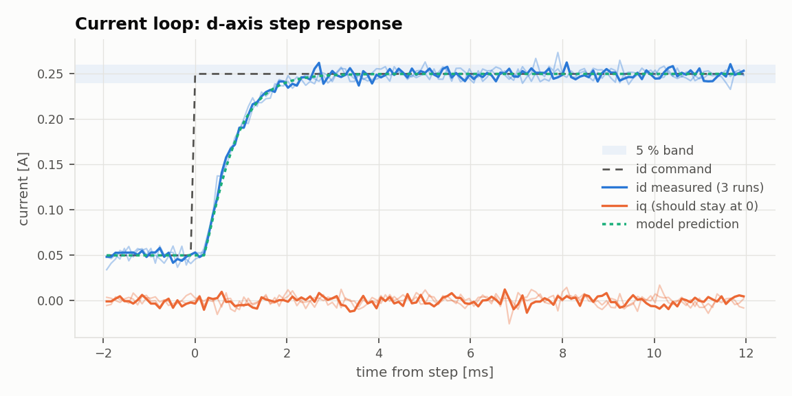
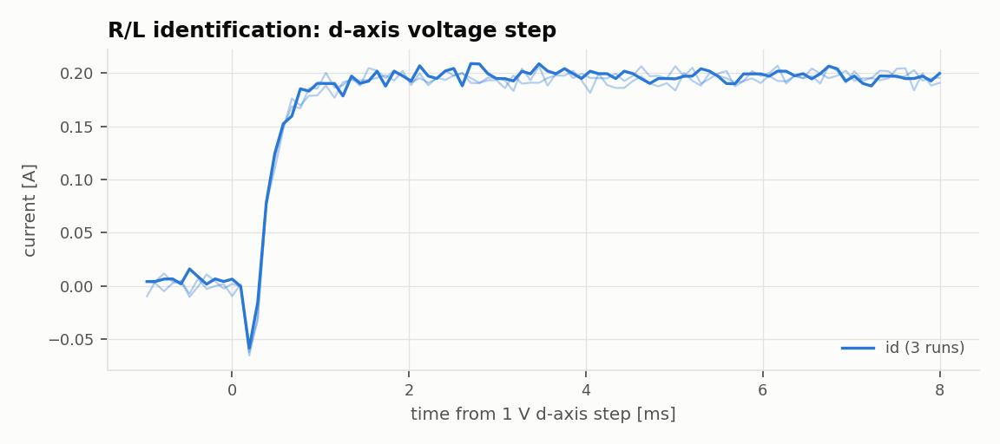

# Custom FOC ESC: Test Report

**4 / 5 requirements passed** · 2026-10-27 09:14 · N = 3 runs per test

## Conditions

| | |
|---|---|
| Firmware build | Oct 27 2026 08:25:57 (protocol v1) |
| Host commit | `efc540d-dirty` |
| Bus voltage | 12.00 V (KD3005P, 0.5 A limit) |
| Motor | GM4108H-120T, 11 pole pairs, no load |
| Current gains | Kp 1.38, Ki 6418 (from measured R, L) |
| Current loop design bandwidth | 200 Hz |
| Speed gains | Kp 0.01, Ki 0 |

## Requirements

Predicted values come from a model of the firmware's control loops using the R, L, Kt and J measured in this same run, so they test the design math, not just the hardware.

| ID | Requirement | Limit | Predicted | Measured (mean ± std) | Result |
|---|---|---|---|---|---|
| REQ-CUR-01 | Current loop rise time (10-90 %) | < 1.5 ms | 1.3 ms | 1.37 ± 0.039 ms | ✅ PASS |
| REQ-CUR-02 | Current loop overshoot | < 10 % | ≈ 0 % | 4.65 ± 1.5 % | ✅ PASS |
| REQ-CUR-03 | Current loop settling time (5 % band) | < 3 ms | 2.02 ms | 4.3 ± 3.3 ms | ❌ FAIL |
| REQ-CUR-04 | d/q decoupling: peak q-axis error during a d-axis step | < 20 % of step | ≈ 0 % of step | 4.49 ± 0.51 % of step | ✅ PASS |
| REQ-CUR-05 | Current steady-state noise (std of id, 20 ms after the step onward) | < 10 mA | – | 5.78 ± 0.062 mA | ✅ PASS |

## Characterization

| Quantity | Measured |
|---|---|
| Phase resistance R | 5.14 ± 0.065 ohm |
| Phase inductance L | 1.14 ± 0.14 mH |
| Electrical time constant L/R | 0.221 ± 0.028 ms |
| Current Kp for 300 Hz (L wc) | 1.38 V/A |
| Current Ki for 300 Hz (R wc) | 6.42e+03 V/(A s) |

## Results

### Current loop step

> Step metrics use the first 20 ms after the step; anything later is reported separately as steady-state noise (REQ-CUR-05).

> Current sense noise before the step is 2.8 % of the step (1 ADC count = 4 mA), so measured overshoot below about twice that is noise, not ringing.

### R/L identification

> tau is only 2.2 samples long at 10.4 kHz, so L is coarse (+/- ~25 %). R is unaffected.

## Method

Run with `python run_bench.py` (see `bench/README.md`). The firmware applies each step at an exact control-loop sample and records 2048 samples to RAM; the host downloads the capture over UART and computes every metric from it. Raw captures are in `raw/` as CSV.
