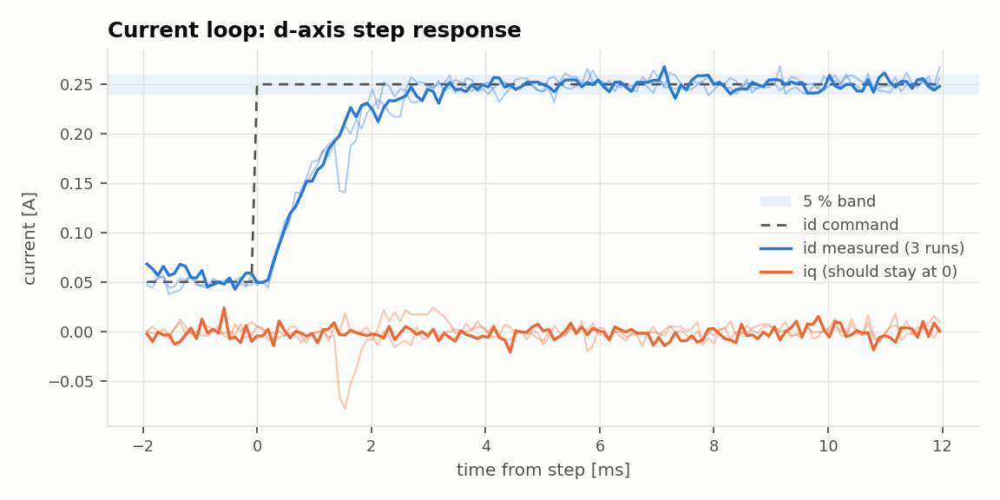
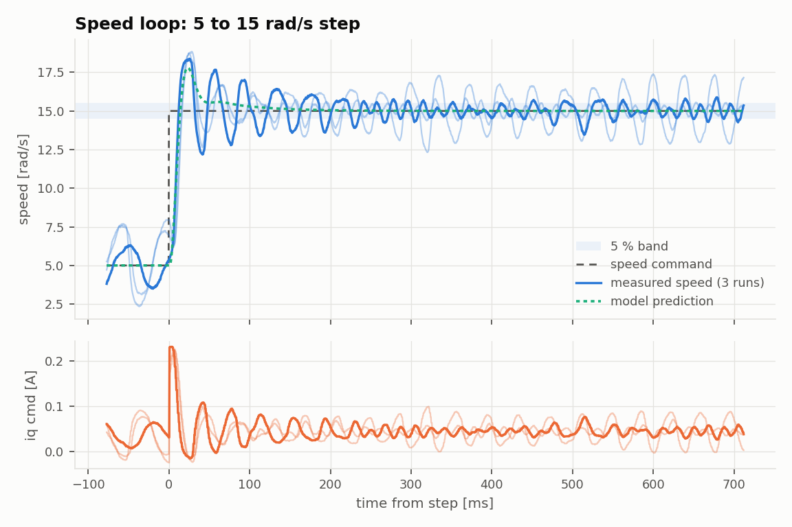
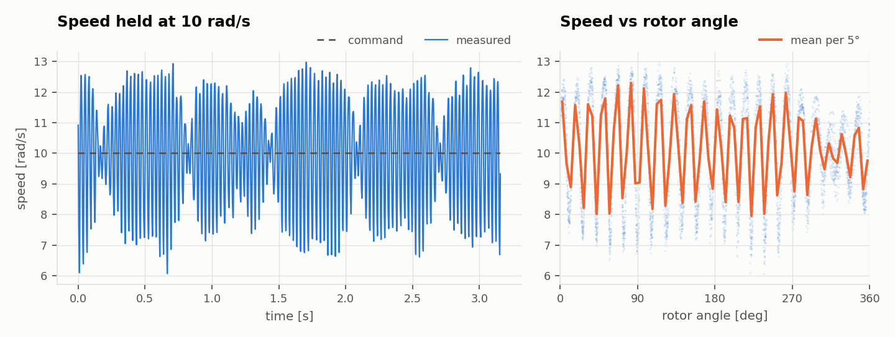

# Custom FOC ESC: Test Report

**6 / 11 requirements passed** · 2026-10-27 09:22 · N = 3 runs per test

## Conditions

| | |
|---|---|
| Firmware build | Oct 27 2026 09:20:45 (protocol v1) |
| Host commit | `efc540d-dirty` |
| Bus voltage | 12.00 V (KD3005P, 0.5 A limit) |
| Motor | GM4108H-120T, 11 pole pairs, no load |
| Current gains | Kp 1, Ki 4886 (firmware defaults) |
| Speed gains | Kp 0.02, Ki 0.31 |

## Requirements

Predicted values come from a model of the firmware's control loops using the R, L, Kt and J measured in this same run, so they test the design math, not just the hardware.

| ID | Requirement | Limit | Predicted | Measured (mean ± std) | Result |
|---|---|---|---|---|---|
| REQ-CUR-01 | Current loop rise time (10-90 %) | < 1.5 ms | – | 1.98 ± 0.36 ms | ❌ FAIL |
| REQ-CUR-02 | Current loop overshoot | < 10 % | – | 4.98 ± 0.88 % | ✅ PASS |
| REQ-CUR-03 | Current loop settling time (5 % band) | < 3 ms | – | 11.1 ± 6.8 ms | ❌ FAIL |
| REQ-CUR-04 | d/q decoupling: peak q-axis error during a d-axis step | < 20 % of step | – | 15.5 ± 16 % of step | ✅ PASS |
| REQ-CUR-05 | Current steady-state noise (std of id, 20 ms after the step onward) | < 10 mA | – | 7.14 ± 0.14 mA | ✅ PASS |
| REQ-SPD-01 | Speed step overshoot (5 to 15 rad/s) | < 20 % | 28 % | 38.9 ± 7.5 % | ❌ FAIL |
| REQ-SPD-02 | Speed step settling time (5 % band) | < 300 ms | 74 ms | 655 ± 35 ms | ❌ FAIL |
| REQ-SPD-03 | Speed steady-state error | < 2 % | ≈ 0 % | 0.125 ± 0.075 % | ✅ PASS |
| REQ-SPD-04 | Speed ripple at 10 rad/s (std / mean) | < 5 % | – | 15.9 ± 0.7 % | ❌ FAIL |
| REQ-SYS-01 | Control ISR worst-case CPU load | < 60 % | – | 47.4 % | ✅ PASS |
| REQ-SAF-01 | Host watchdog disables the drive on link loss | yes | – | yes | ✅ PASS |

## Characterization

| Quantity | Measured |
|---|---|
| Torque constant Kt (back-EMF) | 0.233 ± 0.0022 N m/A |
| Friction current at 10 rad/s | 0.0391 ± 0.0031 A |
| Rotor inertia J (impulse-momentum over the speed step) | 2.83e-05 ± 1.2e-05 kg m² |
| Speed step peak time | 25.3 ± 1.6 ms (model 23.1 ms) |

## Results

### Current loop step

> Step metrics use the first 20 ms after the step; anything later is reported separately as steady-state noise (REQ-CUR-05).

> Current sense noise before the step is 14.6 % of the step (1 ADC count = 4 mA), so measured overshoot below about twice that is noise, not ringing.

> No model prediction: run the rl test in the same session.

### Speed loop step

> Metrics use a 10 ms moving average of vel_mech; the plot shows the raw signal.

### Speed ripple

> R was not measured in this run, so Kt ignores the R*iq drop (upper bound).

## Method

Run with `python run_bench.py` (see `bench/README.md`). The firmware applies each step at an exact control-loop sample and records 2048 samples to RAM; the host downloads the capture over UART and computes every metric from it. Raw captures are in `raw/` as CSV.
