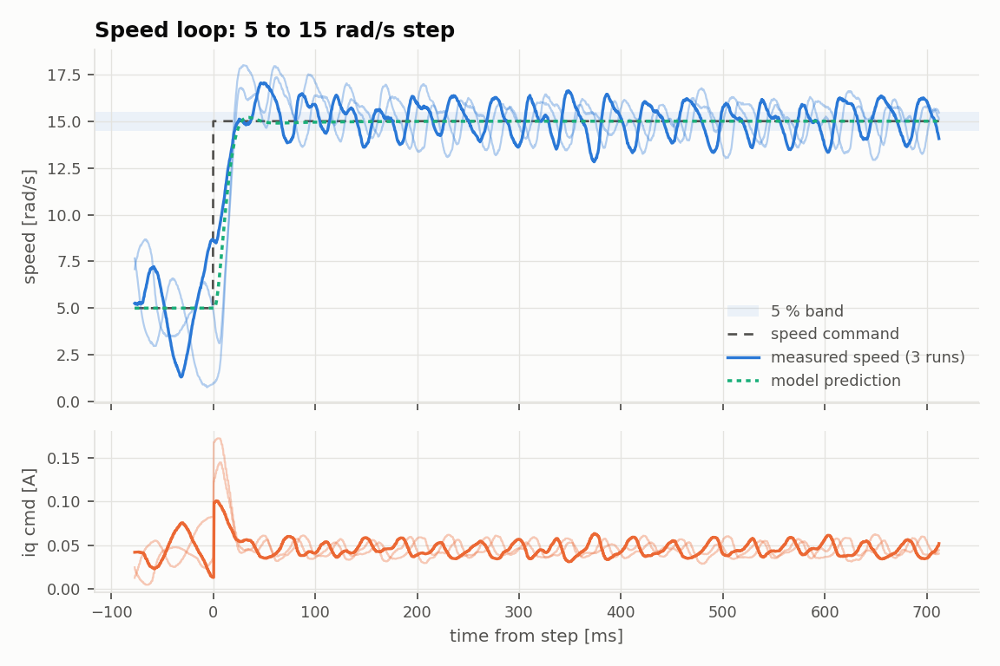
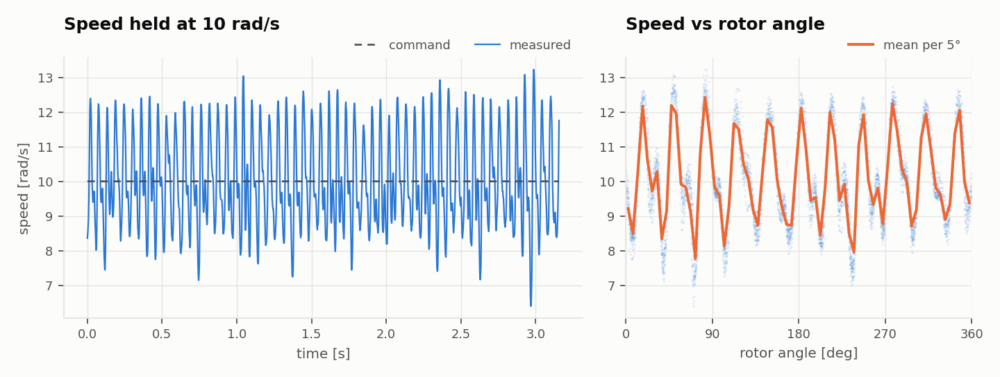

# Custom FOC ESC: Test Report

**1 / 4 requirements passed** · 2026-11-20 16:13 · N = 3 runs per test

## Conditions

| | |
|---|---|
| Target | Hardware (Nucleo-G474RE + ESC + GM4108H) |
| Firmware build | Oct 27 2026 09:25:14 (protocol v1) |
| Host commit | `a3aba97-dirty` |
| Bus voltage | 12.00 V (KD3005P, 0.5 A limit) |
| Motor | GM4108H-120T, 11 pole pairs, no load |
| Current gains | Kp 2.03, Ki 9773 (firmware defaults) |
| Speed gains | Kp 0.0085, Ki 0.13 |

## Requirements

Predicted values come from a model of the firmware's control loops using the R, L, Kt and J measured in this same run, so they test the design math, not just the hardware.

| ID | Requirement | Limit | Predicted | Measured (mean ± std) | Result |
|---|---|---|---|---|---|
| REQ-SPD-01 | Speed step overshoot (5 to 15 rad/s) | < 20 % | 2 % | 22.4 ± 1.2 % | ❌ FAIL |
| REQ-SPD-02 | Speed step settling time (5 % band) | < 300 ms | 23.9 ms | 702 ± 0.82 ms | ❌ FAIL |
| REQ-SPD-03 | Speed steady-state error | < 2 % | ≈ 0 % | 0.185 ± 0.13 % | ✅ PASS |
| REQ-SPD-04 | Speed ripple at 10 rad/s (std / mean) | < 5 % | – | 13.2 ± 0.58 % | ❌ FAIL |

## Characterization

| Quantity | Measured |
|---|---|
| Torque constant Kt (back-EMF) | 0.221 ± 0.011 N m/A |
| Friction current at 10 rad/s | 0.0392 ± 0.0032 A |
| Rotor inertia J (impulse-momentum over the speed step) | 2.33e-05 ± 5.5e-06 kg m² |
| Speed step peak time | 47.5 ± 17 ms (model 34.3 ms) |

## Results

### Speed loop step

> Metrics use a 10 ms moving average of vel_mech; the plot shows the raw signal.

### Speed ripple

> R was not measured in this run, so Kt ignores the R*iq drop (upper bound).

## Method

Run with `python run_bench.py` (see `bench/README.md`). The firmware applies each step at an exact control-loop sample and records 2048 samples to RAM; the host downloads the capture over UART and computes every metric from it. Raw captures are in `raw/` as CSV.
