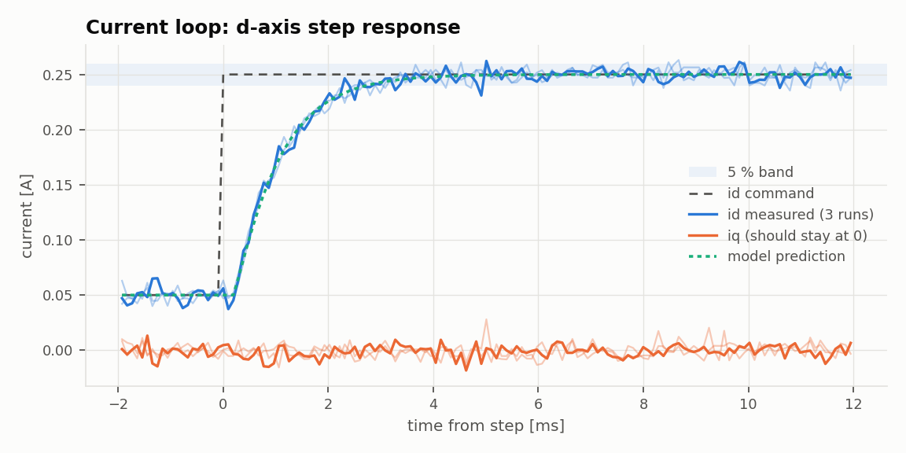
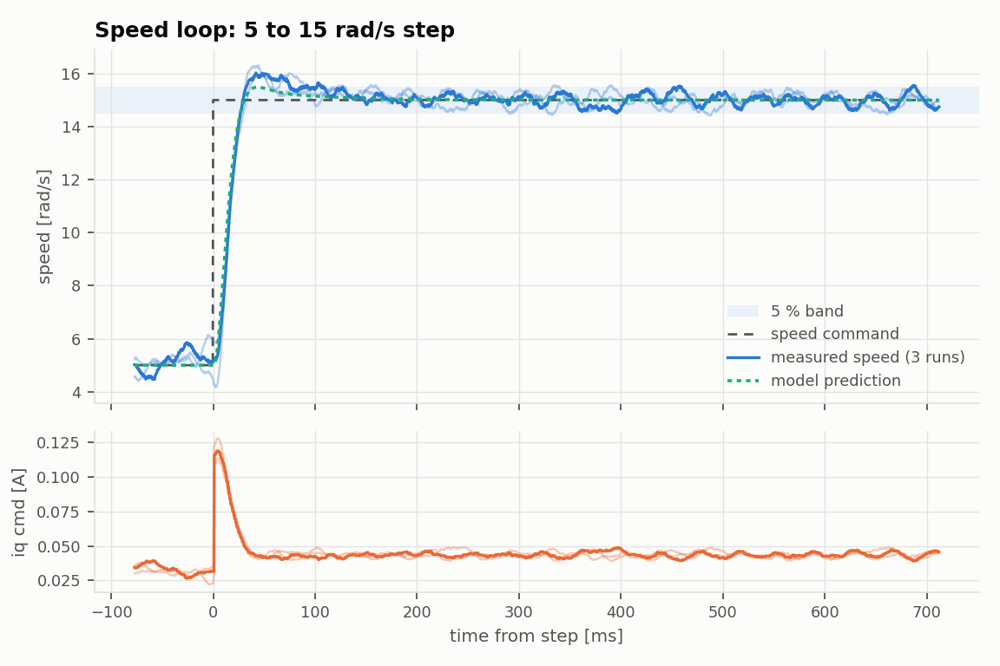
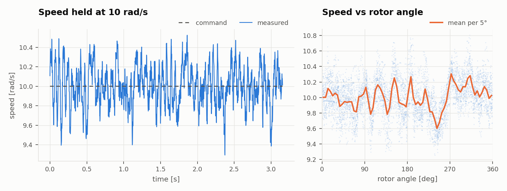
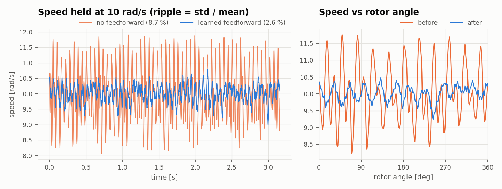
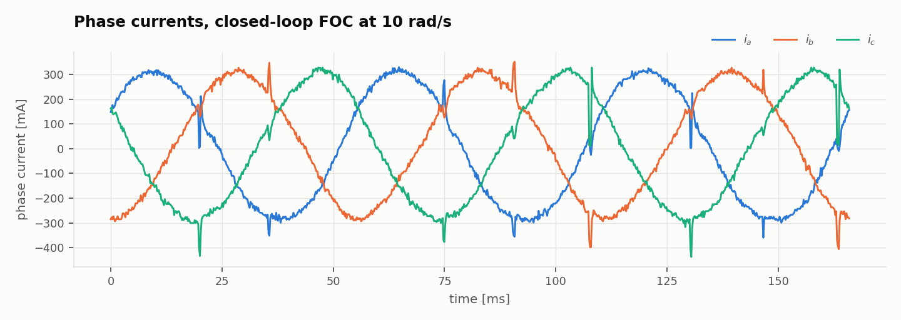
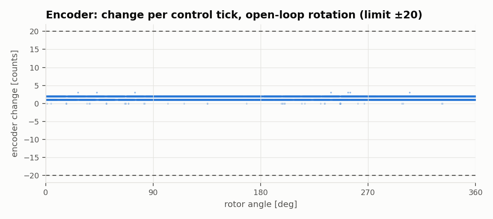
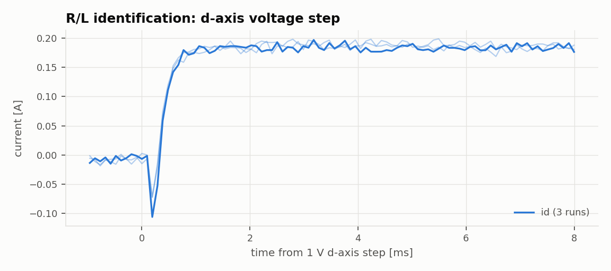

# Custom FOC ESC: Test Report

**10 / 12 requirements passed** · 2026-11-20 17:19 · N = 3 runs per test

## Conditions

| | |
|---|---|
| Target | Hardware (Nucleo-G474RE + ESC + GM4108H) |
| Firmware build | Nov 20 2026 16:32:03 (protocol v2) |
| Host commit | `a3aba97-dirty` |
| Bus voltage | 12.00 V (KD3005P, 0.5 A limit) |
| Motor | GM4108H-120T, 11 pole pairs, no load |
| Current gains | Kp 1, Ki 4886 (firmware defaults) |
| Speed gains | Kp 0.0085, Ki 0.13 |
| Notes | cogging feedforward learned in-run |

## Requirements

Predicted values come from a model of the firmware's control loops using the R, L, Kt and J measured in this same run, so they test the design math, not just the hardware.

| ID | Requirement | Limit | Predicted | Measured (mean ± std) | Result |
|---|---|---|---|---|---|
| REQ-CUR-01 | Current loop rise time (10-90 %) | < 2.5 ms | 1.85 ms | 1.83 ± 0.041 ms | ✅ PASS |
| REQ-CUR-02 | Current loop overshoot | < 10 % | ≈ 0 % | 4.52 ± 0.96 % | ✅ PASS |
| REQ-CUR-03 | Current loop settling time (5 % band) | < 4 ms | 2.79 ms | 6.49 ± 6.1 ms | ❌ FAIL |
| REQ-CUR-04 | d/q decoupling: peak q-axis error during a d-axis step | < 20 % of step | ≈ 0 % of step | 5.54 ± 1.1 % of step | ✅ PASS |
| REQ-CUR-05 | Current steady-state noise (std of id, 20 ms after the step onward) | < 10 mA | – | 5.64 ± 0.08 mA | ✅ PASS |
| REQ-SPD-01 | Speed step overshoot (5 to 15 rad/s) | < 20 % | 4.87 % | 10.5 ± 1.8 % | ✅ PASS |
| REQ-SPD-02 | Speed step settling time (5 % band) | < 300 ms | 27 ms | 313 ± 1.9e+02 ms | ❌ FAIL |
| REQ-SPD-03 | Speed steady-state error | < 2 % | ≈ 0 % | 0.232 ± 0.15 % | ✅ PASS |
| REQ-SPD-04 | Speed ripple at 10 rad/s (std / mean) | < 5 % | – | 2.38 ± 0.46 % | ✅ PASS |
| REQ-ENC-01 | Encoder read glitches during slow open-loop rotation (jump > 20 counts) | < 0.1 per s | – | 0 per s | ✅ PASS |
| REQ-SYS-01 | Control ISR worst-case CPU load | < 60 % | – | 50.2 % | ✅ PASS |
| REQ-SAF-01 | Host watchdog disables the drive on link loss | yes | – | yes | ✅ PASS |

## Characterization

| Quantity | Measured |
|---|---|
| Phase resistance R | 5.07 ± 0.053 ohm |
| Phase inductance L | 0.938 ± 0.13 mH |
| Electrical time constant L/R | 0.185 ± 0.024 ms |
| Current Kp for 300 Hz (L wc) | 1.82 V/A |
| Current Ki for 300 Hz (R wc) | 9.51e+03 V/(A s) |
| Torque constant Kt (back-EMF) | 0.202 ± 0.0038 N m/A |
| Friction current at 10 rad/s | 0.0351 ± 0.0027 A |
| Rotor inertia J (impulse-momentum over the speed step) | 2.19e-05 ± 4.3e-06 kg m² |
| Speed step peak time | 45.7 ± 4.3 ms (model 43.6 ms) |
| Largest encoder jump between ticks | 3 counts |
| Speed ripple at 10 rad/s without cogging feedforward | 8.7 % |
| Speed ripple at 10 rad/s after learning | 2.63 % |
| Rotor inertia J (from the learning step's response) | 2.06e-05 kg m² |
| Largest feedforward harmonic | 0.0253 A |
| Phase current amplitude mismatch (max - min) / mean | 0.803 ± 0.36 % |
| Worst phase spacing error from 120° | 0.181 ± 0.07 deg |
| Largest phase current DC offset in closed loop | 9.15 ± 1.5 mA |

## Results

### Current loop step

> Step metrics use the first 20 ms after the step; anything later is reported separately as steady-state noise (REQ-CUR-05).

> Current sense noise before the step is 2.9 % of the step (1 ADC count = 4 mA), so measured overshoot below about twice that is noise, not ringing.

### Speed loop step

> Metrics use a 10 ms moving average of vel_mech; the plot shows the raw signal.

### Speed ripple

### Cogging feedforward

> Learned in 5 updates at 10 rad/s, harmonics 1, 2, 11, 22, 24, 33, 44, 48 per revolution. Later speed tests in this run use it.

### Phase currents

> 300 mA on the d-axis (no torque) while holding 10 rad/s, so the waveform is large compared with the 4 mA ADC step. Cogging feedforward off for this capture.

### Encoder integrity

### R/L identification

> tau is only 2.0 samples long at 10.4 kHz, so L is coarse (+/- ~25 %). R is unaffected.

## Method

Run with `python run_bench.py` (see `bench/README.md`). The firmware applies each step at an exact control-loop sample and records 2048 samples to RAM; the host downloads the capture over UART and computes every metric from it. Raw captures are in `raw/` as CSV.
